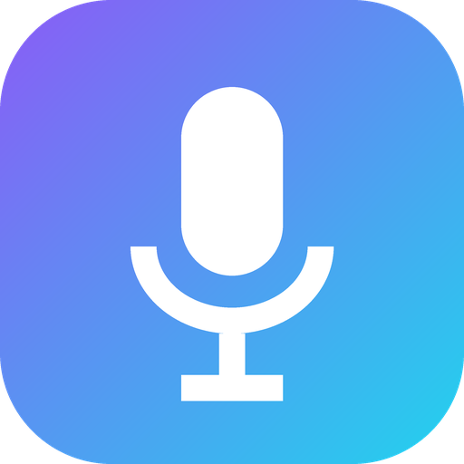
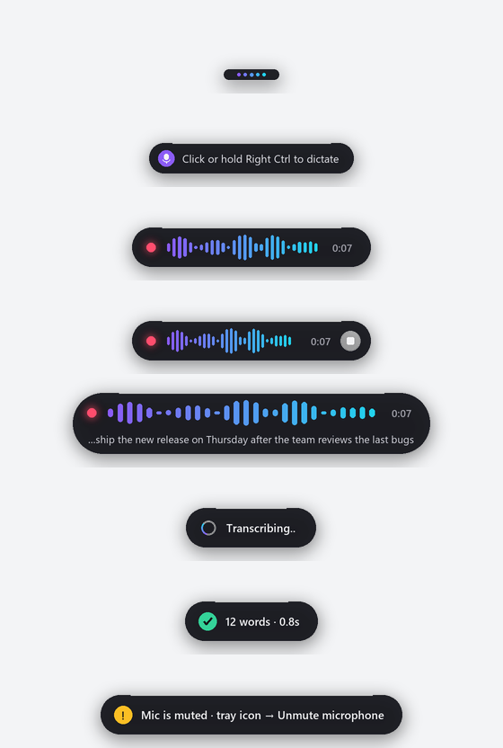
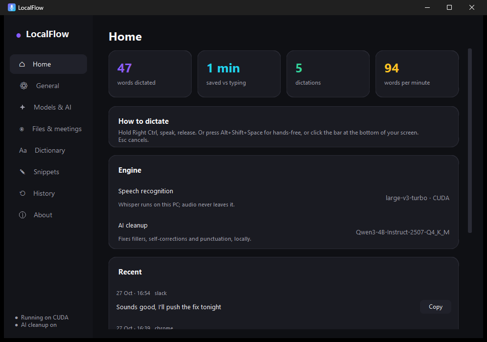

<p align="center"></p>

<h1 align="center">LocalFlow</h1>
<p align="center"><b>Private voice dictation for Windows that runs entirely on your PC.</b><br>
Hold a key, speak, let go: your words appear, cleaned up, in any app. Nothing leaves your computer.</p>

<p align="center"><a href="../../releases/latest"><b>⬇ Download for Windows</b></a></p>

<p align="center"></p>

## Features

- **Works in every app:** Slack, Gmail, VS Code, ChatGPT, Word, terminals and more.
- **Fast:** about 1 second from the end of speech to text on an NVIDIA GPU (Whisper large-v3-turbo, int8).
- **AI cleanup:** a local Qwen3-4B model removes "um"s and "uh"s, applies self-corrections ("5, no wait, 6" becomes "6"), turns spoken lists into numbered lists, and fixes punctuation. Questions are never answered, only transcribed.
- **Matches the text around your cursor:** capitals, spacing and punctuation fit what you're writing, and names on screen are spelled correctly. It reads that text through Windows UI Automation, locally, and never from password fields.
- **Dictionary, replacements and snippets** for names, jargon and text you insert often.
- **Dictation bar:** an always-on mini bar you can click to dictate, with a live waveform. It never takes focus from your app.
- **Respects your clipboard:** it's restored after every paste, and dictations stay out of Win+V history and cloud clipboard sync.
- **No typing lag:** hotkeys use Raw Input, so LocalFlow can never slow down your keyboard.
- **Edit by voice:** select text, hold Right Alt, and say "make this formal" or "translate to Hindi". With nothing selected, it writes new text at the cursor.
- **Meeting notes:** records your mic and your computer's audio, labels lines You and Others, and writes a local summary with action items as Markdown.
- **Transcribe files:** audio or video becomes `.txt` and `.srt` subtitles.
- **Live preview** in the bar while you speak, **learns from your corrections**, a **writing style per app**, and **one-click updates**.

| Action | Default |
|---|---|
| Hold to talk | **Right Ctrl** |
| Hands-free on/off | **Alt+Shift+Space**, or click the bar |
| Cancel | **Esc** |
| Edit selected text by voice | hold **Right Alt** |
| Paste last transcript | **Alt+Shift+Z** |
| Line breaks | say **"new line"** or **"new paragraph"** |

<p align="center"></p>

## Install

Download **LocalFlow-Setup.exe** from [Releases](../../releases/latest) and run it. It installs for your user only, so no admin rights are needed. On first launch, LocalFlow downloads its models once from their official sources, pinned to exact versions and verified by SHA-256:

| Download | Size | When |
|---|---|---|
| Whisper large-v3-turbo | 1.6 GB | NVIDIA GPU (otherwise Whisper small, 0.5 GB, on the CPU) |
| NVIDIA cuBLAS / cuDNN | 1.4 GB | NVIDIA GPU only |
| Qwen3-4B-Instruct + llama.cpp | 2.5 GB | optional AI cleanup |

After that, LocalFlow works completely offline.

## Privacy

- Audio is held in memory and discarded after transcription.
- Text around the cursor is read locally and only passed to the local models.
- History is a local SQLite file (`%APPDATA%\LocalFlow\history.db`). You can turn it off or clear it in Settings.
- Logs record timings and lengths, never what you said.

## Run from source

```powershell
py -3.13 -m venv .venv
.venv\Scripts\python -m pip install -r requirements.txt
.\LocalFlow.bat                       # first run downloads the AI cleanup engine and model
```

Build the app and installer with `pyinstaller packaging\LocalFlow.spec`, then `ISCC packaging\LocalFlow.iss` (see `.github/workflows/release.yml`).

## Tests

```powershell
.venv\Scripts\python -m pytest tests -q        # formatting, hotkeys, AI guard rails
.venv\Scripts\python tests\e2e_notepad.py      # full pipeline with synthetic speech in Notepad
.venv\Scripts\python tests\smoke_app.py        # drives the real app through record/stop cycles
LocalFlow.exe --self-test result.json          # headless check of an installed build
```

## Troubleshooting

- **"Mic is muted":** right-click the tray icon and choose **Unmute microphone**.
- **Nothing is typed into an app running as administrator:** Windows blocks this. LocalFlow leaves the text on the clipboard; press Ctrl+V.
- **A shortcut doesn't work:** another app may own it. LocalFlow tells you which one; pick a different shortcut in Settings → General.
- Logs, including `crash.log`, are in `%APPDATA%\LocalFlow\logs`.

## License

MIT. Models and libraries keep their own licences; see [THIRD_PARTY_NOTICES.md](THIRD_PARTY_NOTICES.md).
